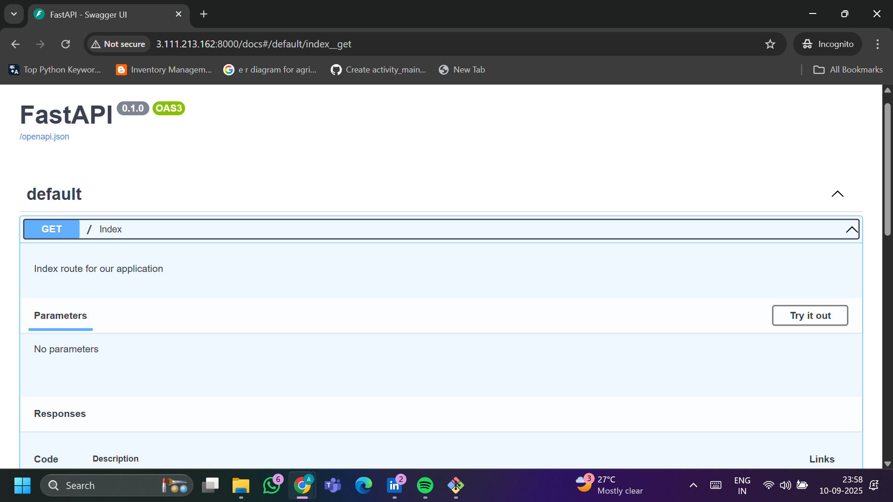
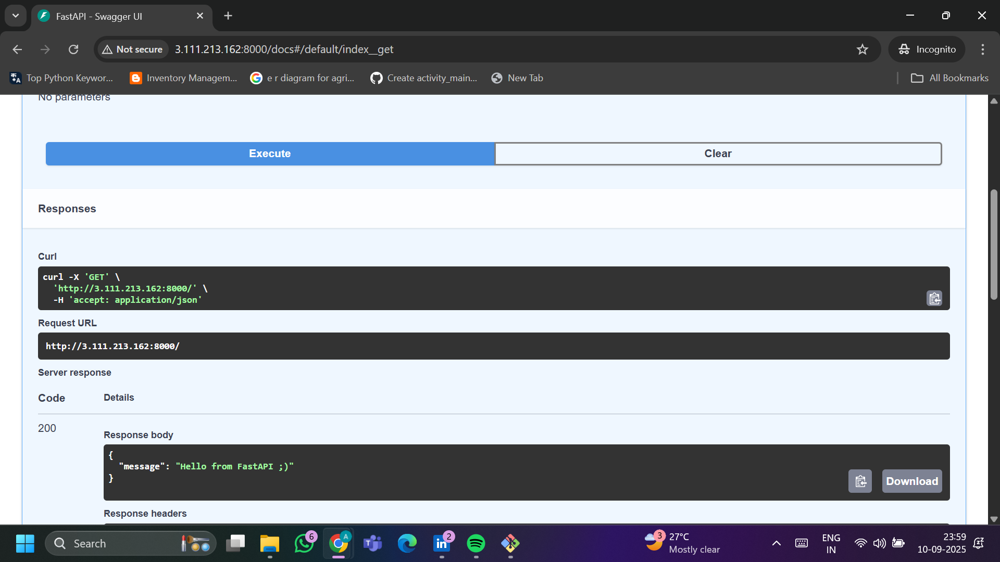
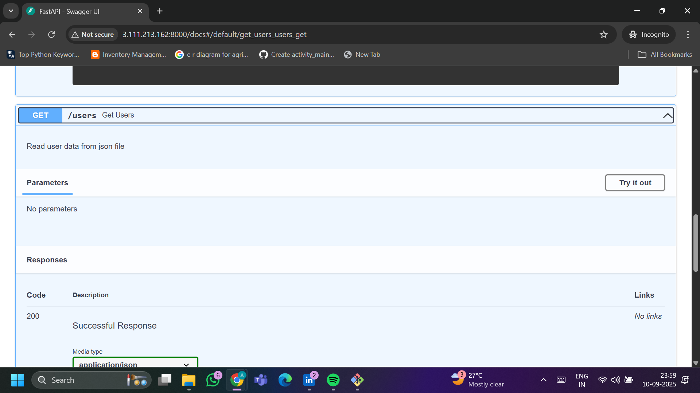
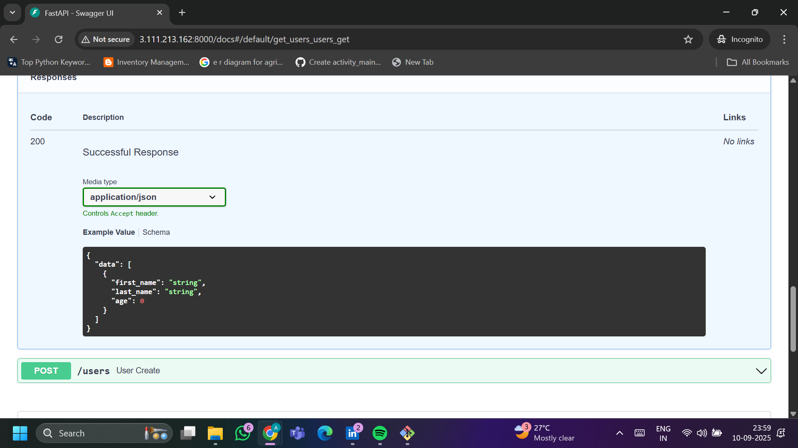
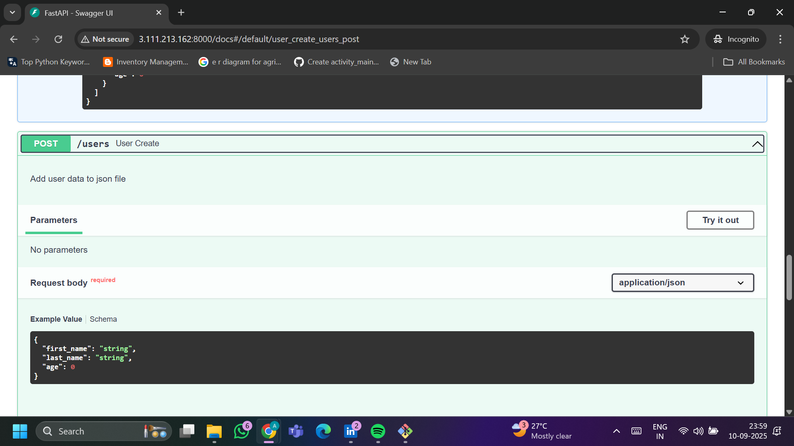
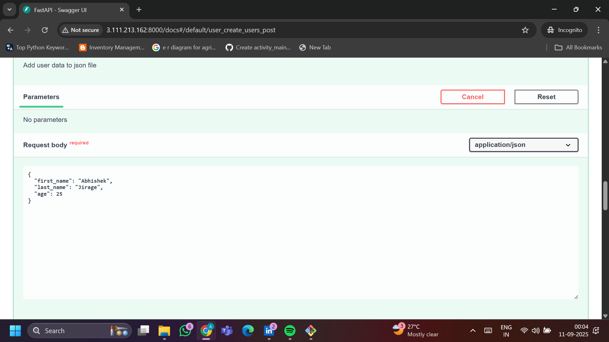
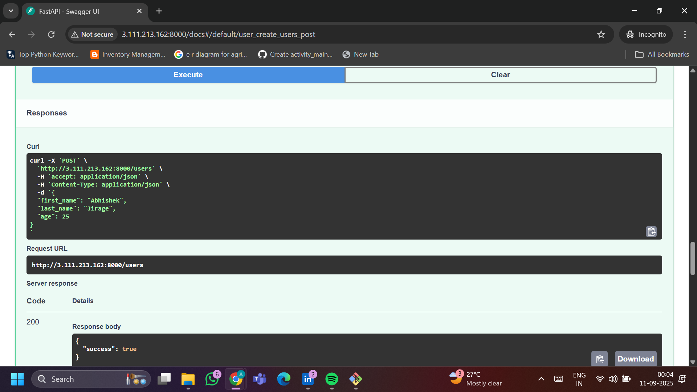
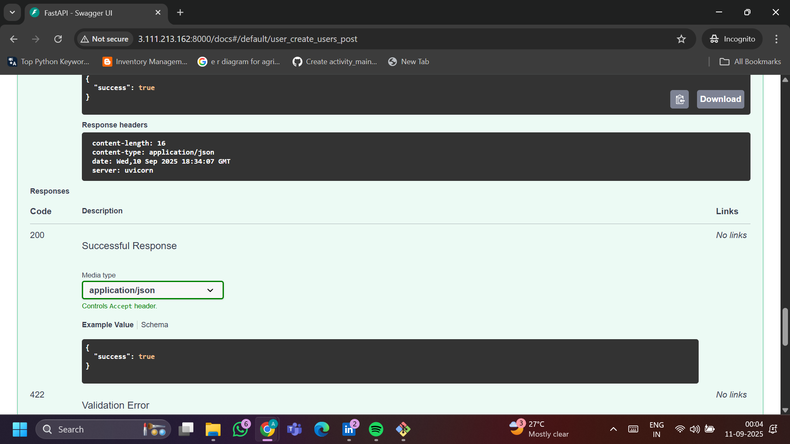

# docker-fastapi-test
#  Dockerized FastAPI App – Persistent Users JSON

This project is a **FastAPI application** that demonstrates how to run a simple API inside a **Docker container** with **docker-compose**.  
It uses a persistent `users.json` file (mounted as a volume) to store user data so that data is not lost even if the container restarts.

---

##  Project Structure
docker-fastapi-test/
├── app/
│ ├── main.py # FastAPI application code
│ ├── requirements.txt # Python dependencies
│ └── ...
├── data/
│ └── users.json # Persistent user data (mounted volume)
├── Dockerfile # Docker image definition
├── docker-compose.yml # Compose file for running the container
└── .dockerignore # Files to ignore during build


---

##  Prerequisites

- **Docker** installed → [Install Docker](https://docs.docker.com/get-docker/)
- **Docker Compose** installed → [Install Compose](https://docs.docker.com/compose/install/)

---
#  Docker FastAPI Project on AWS EC2

This project demonstrates how to deploy a FastAPI application using Docker on an AWS EC2 instance.  
It is a step-by-step guide from launching the EC2 instance to running the application.

---

##  Prerequisites

Before starting, ensure you have:
- An **AWS account**
- Basic knowledge of:
  - Linux commands
  - Git
  - Docker
- Installed locally (for development):
  - [VS Code](https://code.visualstudio.com/)
  - [Git](https://git-scm.com/)

---

##  Launch an EC2 Instance

1. Log in to **AWS Management Console** → Go to **EC2**.
2. Click **Launch Instance**.
3. Configure:
   - **Name:** `docker-fastapi-test`
   - **AMI:** Ubuntu 22.04 LTS
   - **Instance type:** t2.micro (Free Tier)
   - **Key pair:** Create new key pair (or use existing).
   - **Security group:** Allow:
     - SSH (port 22)
     - HTTP (port 80)
     - Custom TCP (port 8000 for FastAPI)
4. Launch the instance.

---

##  Connect to the EC2 Instance

```bash
ssh -i "your-key.pem" ubuntu@<your-ec2-public-ip>
```
***Install Required Packages***

Update system & install dependencies:
```bash 
sudo apt update && sudo apt upgrade -y
sudo apt install git docker.io docker-compose -y
sudo systemctl enable docker
sudo systemctl start docker
```
### Check Docker is running:
```bash
    docker --version
```
##  Setup & Run

1. **Clone the Repository**
   ```bash
   git clone https://github.com/<your-username>/docker-fastapi-test.git
   cd docker-fastapi-test

2 **Build & Start Containers**
```bash
  docker-compose up -d --build
```
3 **Check Running Containers**
```bash
docker ps
```
***Access the API***
```bash
Open browser: http://localhost:8000

Interactive API docs: http://localhost:8000/docs
```
**Example Usage**
1 Get All Users
```bash
curl http://localhost:8000/users
```
2 Add a New User
```bash
curl -X POST http://localhost:8000/users \
-H "Content-Type: application/json" \
-d '{"first_name": "Abhishek", "last_name": "Jirage", "age": 25}'
```
**Stop & Remove Containers**
```bash
docker-compose down
```
***Development Notes***

Persistent Data → The data/users.json file is mounted as a Docker volume. Your data will remain even after restarting the container

***Rebuild Image (if you change code):***
```bash
docker-compose up -d --build
```
## Output







